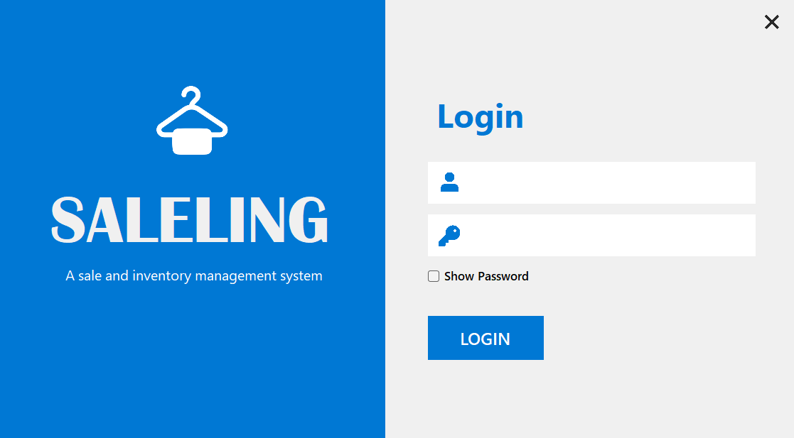
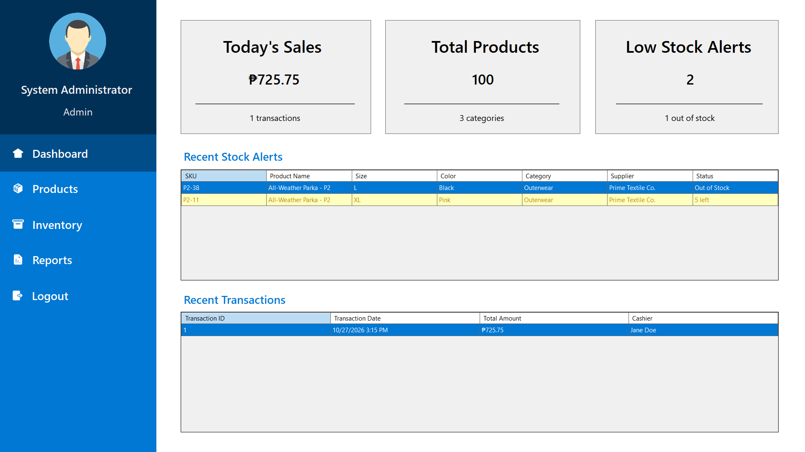
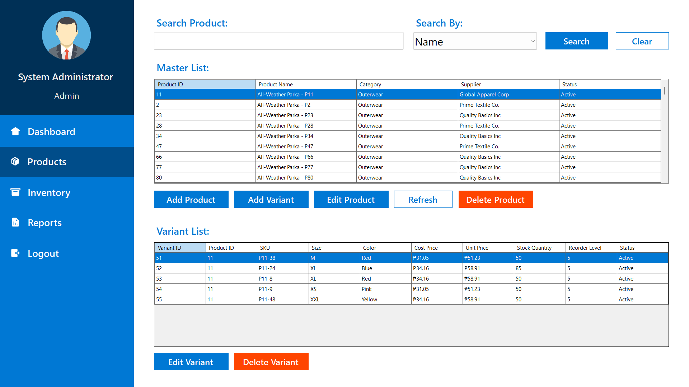
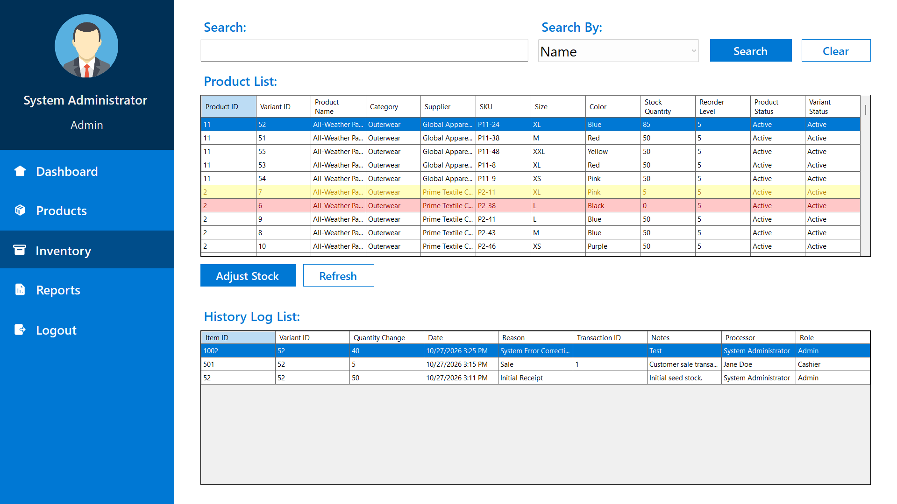
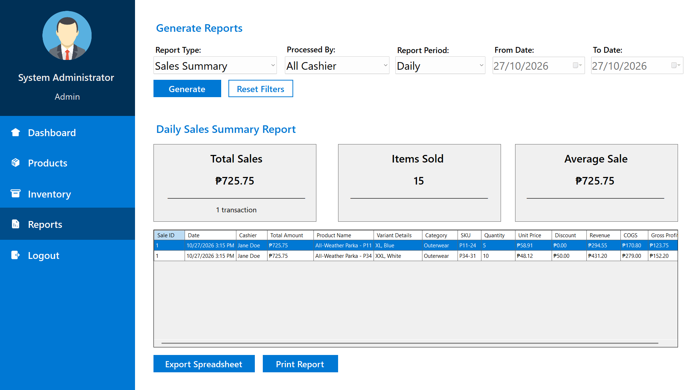
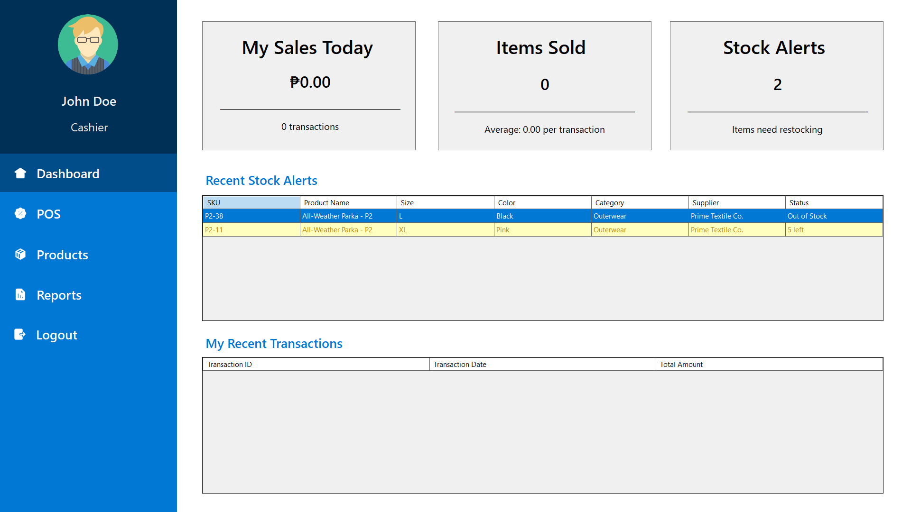
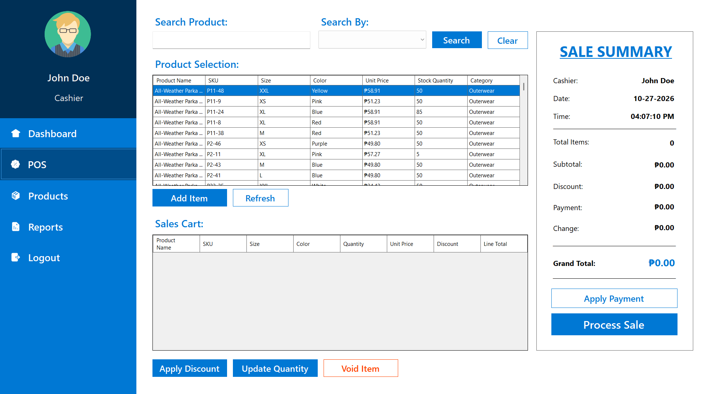

# 👚 Saleling: Sales & Inventory Management System

**Saleling** is a comprehensive **Point-of-Sale (POS) and Inventory Management System** specifically designed for a **clothing apparel business**. Developed as a **Windows Forms application**, it utilizes an **event-driven** approach and strictly adheres to the **UI-Model-Controller-Repository (UMCR)** architectural pattern to ensure scalability, maintainability, and a clear separation of concerns.

---

## ✨ Core Features

This system provides all the essential functionalities needed for retail operations, with robust technical and data-integrity features.

### Business Functionalities

| Feature Area | Description | Requirement |
| :--- | :--- | :--- |
| **User & Access** | Secure Login with role-based access | Login, User Role Management |
| **Dashboards** | Dedicated **Admin Dashboard** for high-level oversight and a streamlined **Cashier Dashboard** for sales operations. | Admin Dashboard, Cashier Dashboard |
| **Product Management** | Complete **Product Maintenance (CRUD)** functionality, seeded with **100 sample products** (about 5 variants each). Products can be searched efficiently by **name, category, SKU or supplier**. | Product Maintenance, Product Search |
| **Inventory Control** | Real-time tracking of the **Number of Inventory Items**. Automated **Stock Level Alerts** notify staff when apparel stock is low. | Inventory Items, Stock Level Alerts |
| **Sales & Transactions** | Core **Cashiering/Sales** module. Every transaction is saved to the **Transaction History** for auditing. | Cashiering/Sales, Transaction History |
| **Reporting** | Generation of detailed **Inventory and Sales Reports** based on collected sales and stock data. | Inventory & Sales Report |

---

## 📸 Screenshots

### Login



### Admin

| Dashboard | Product Maintenance |
| :---: | :---: |
|  |  |

| Inventory Management | Reports |
| :---: | :---: |
|  |  |

### Cashier

| Dashboard | Point of Sale |
| :---: | :---: |
|  |  |

---

## 🛠️ Technical Implementation

### Architecture: UI-Model-Controller-Repository (UMCR)

The project separates concerns across four distinct layers:

* **UI (User Interface):** Built with **Windows Forms** to display data and handle all **event-driven programming** interactions.
* **Model:** Simple C\# objects that define the data structure (e.g., `ProductModel`, `ProductVariantModel`, `UserModel`, `SalesTransactionModel`).
* **Controller:** Contains the application's **business logic**. It receives input from the UI and coordinates data flow with the Repository.
* **Repository:** Manages all **data access** operations (CRUD) against the database, abstracting the data source from the Controller.

### Code & Security Principles

* **Secure Password Hashing:** User passwords are secured using the **BCrypt algorithm**, providing strong, slow hashing to protect against brute-force attacks.
* **Role-Based Authorization:** The controllers enforce roles themselves, not just the UI. Only **Admins** can maintain products, adjust inventory, list cashiers and see store-wide sales, and only **Cashiers** can process sales. Cashiers can only view their own sales data. Roles are also constrained in the database (`Admin` or `Cashier`), and stock can never go below zero.
* **Error Management:** Extensive use of **`try-catch` / `throw exception`** throughout the application to handle and log errors gracefully, especially in data access and critical business logic.
* **Data Structures:** **C\# Collections** (e.g., `List<T>`) are used to efficiently store and manage groups of related objects, like the product catalog or items in a shopping cart.

### Data Integrity & Database Features

* **Transaction Management:** Implementation of **Database Transact / Rollback** logic ensures data integrity during multi-step operations (e.g., if inventory update fails, the sale record rolls back).
* **Performance:** Utilizes **Stored Procedure** for complex or frequently executed queries.
* **Reporting Queries:** Sales and inventory reports and KPIs are produced by dedicated stored procedures (e.g., `sp_GenerateSalesReport`, `sp_GetInventoryStockKPIs`), keeping aggregation logic in the database.

### Configuration & Logging

* **Configuration File:** An external configuration file holds the **database connection string** and other application settings, allowing for easy updates without code changes.
* **Log File:** All application events, errors, and critical transaction details are saved to the file named **`Saleling-Debug.logs`**. This file can be found in the application's runtime directory: `\bin\Debug\net8.0-windows`.

---

## 👥 Team / Collaborators

This project was developed by the following students:

| Role | Github | Email |
| :--- | :--- | :--- |
| **Leader** | [mowtiie](https://github.com/mowtiie) | contact@mowtiie.cc |
| **Member** | [Tutsy](https://github.com/Tutsy) | markkerwinballelos@gmail.com |
| **Member** | [villalobosjames30](https://github.com/villalobosjames30) | villalobosjamescarl30@gmail.com |
| **Member** | [Adrienne20894](https://github.com/Adrienne20894) | jaloconadrienne@gmail.com |

---

## 🎓 Instructor / Professor

| Role | Github | Email |
| :--- | :--- | :--- |
| **Professor** | [ErvinAbiadSTI](https://github.com/ErvinAbiadSTI) | ervin.abiad@gmail.com |

---

## 🛠️ Tech Stack

* **Programming Language:** C# (.NET 8, Windows Forms)
* **Database:** Microsoft SQL Server
* **Version Control:** Git & Github
* **IDE:** Microsoft Visual Studio & SQL Server Management Studio

---

## 📦 Required NuGet Packages

The following packages are referenced by the projects (restored automatically by NuGet) to handle configuration, database access, and password hashing:

* **`System.Configuration.ConfigurationManager` (9.0.8, `Saleling.Util`):** Used to read the database connection string and application settings from the configuration file.
* **`Microsoft.Data.SqlClient` (5.2.2, `Saleling.Repository`):** The primary provider for connecting to and interacting with the Microsoft SQL Server database.
* **`BCrypt.Net-Next` (4.0.3, `Saleling.Util`):** Provides the implementation of the **BCrypt hashing algorithm** for securing user passwords.

---

## 🚀 Setup & Execution

### Prerequisites

* **Visual Studio 2022** with the **.NET desktop development** and **Data storage and processing** (SQL Server Data Tools) workloads. The `Saleling.DB` project is an SSDT project, so `dotnet build` cannot build or publish it.
* **.NET 8 SDK**
* **SQL Server LocalDB** (installed with the Data storage and processing workload)

### Steps

1.  **Clone the Repository:**
    ```bash
    git clone https://github.com/mowtiie/Saleling
    ```
2.  **Open the Solution:** Open `Saleling.sln` in Visual Studio.
3.  **Publish the Database:**
    * Right-click the `Saleling.DB` project and choose **Publish**.
    * Set the target database connection to server `(localdb)\MSSQLLocalDB` and the **database name to `Saleling.DB`** (the application connects to this exact name).
    * Click **Publish**. This creates the schema and runs the seed script (users, categories, suppliers, a walk-in customer, and 100 sample products).
    * The seed script skips any data that already exists, so re-publishing is safe.
4.  **Check the Connection String:** The application is configured to use the following connection string for local development in `Saleling.UI/App.config`:
    ```
    Data Source=(localdb)\MSSQLLocalDB;Initial Catalog=Saleling.DB;Integrated Security=True
    ```
    Change it if your SQL Server instance or database name is different. To override it without editing files (for example on another machine), set the `SALELING_CONNECTION_STRING` environment variable; it takes priority over `App.config`.
5.  **Run the Project:** Set `Saleling.UI` as the startup project, then build and run the application (F5).

### Running the Tests

```bash
dotnet test Saleling.Controller.Tests
```

Most tests need no database. The integration tests create a throwaway database on your `(localdb)\MSSQLLocalDB` instance from the `Saleling.DB` scripts and drop it afterwards, so they never touch your real `Saleling.DB` data. If LocalDB is not available they are skipped, not failed. The tests always use the LocalDB connection string in the test project, even if `SALELING_CONNECTION_STRING` is set.

The same tests run on every push and pull request through GitHub Actions (`.github/workflows/ci.yml`). The workflow builds the C# projects individually, because `Saleling.DB` is an SSDT project that `dotnet` cannot build.

### Default Login Credentials (Demo Only)

> **Warning:** These accounts are seeded by `PostDeployment.sql` for demonstration and grading purposes only. Their passwords are published in this README and the application does not force a password change, so **never deploy with these accounts**. Before any real use, delete them or change their passwords.

*Note: Passwords are BCrypt-hashed in the database. These are the plaintext values for login.*

| Role | Username | Password |
| :--- | :--- | :--- |
| **Admin** | `sysadmin` | `footpath1dangeravenge2` |
| **Cashier** | `johndoe` | `buggysnow1fieldapproach2` |
| **Cashier** | `janedoe` | `brown1nosemule2` |
